# 🚀 Awesome Git Repository Management & Self-Hosted Git Servers

 

**A curated directory of top Git repository management platforms, self-hosted Git servers, lightweight code forges, and enterprise DevOps suites.**

*Compare GitHub alternatives, self-hosted Git servers, open-source code collaboration platforms, and cloud Git hosting providers.*

---

## 📖 Overview

Looking for the best **Git repository management software**, a **lightweight self-hosted Git forge**, or an **enterprise-ready GitHub alternative**? 

This curated list benchmarks leading **cloud SaaS platforms** and **open-source Git hosting projects**. Whether you are provisioning a homelab server on a Raspberry Pi, looking for data-sovereign version control to eliminate per-seat licensing, or scaling an enterprise CI/CD development pipeline, this guide provides side-by-side pricing, free tier limits, hardware profiles, and feature comparisons.

### 🎯 Key Evaluation Criteria
- 🔄 **Deployment Flexibility**: Cloud SaaS vs. single-binary on-premise vs. containerized Kubernetes clusters.
- 💾 **Resource Footprint**: Minimalist forges (~100 MB–1 GB RAM) vs. complete DevSecOps platforms (4 GB+ RAM).
- ⚡ **CI/CD Integration**: Built-in native workflow engines vs. GitHub Actions compatibility vs. external runner hooks.
- 🛡️ **Data Sovereignty & Licensing**: FOSS/GPL community governance vs. MIT/open-core vs. commercial proprietary SaaS.

---

## 📑 Table of Contents

- 🌐 [Sector Overview & Market Dynamics](#-sector-overview--market-dynamics)
- 🧭 [Quick Decision Matrix: Choosing the Right Git Platform](#-quick-decision-matrix-choosing-the-right-git-platform)
- ☁️ [SaaS & Hosted Git Platforms](#️-saas--hosted-git-platforms)
- 🐙 [Open-Source Git Servers & Repositories](#-open-source-git-servers--repositories)
- 🏗️ [Architectural Comparison & Hardware Requirements](#️-architectural-comparison--hardware-requirements)
- 🤝 [How to Contribute](#-how-to-contribute)
- ⚖️ [Disclaimer & License](#️-disclaimer--license)

---

## 🌐 Sector Overview & Market Dynamics

The global Version Control Systems (VCS) and Git Repository Management market is estimated at **$1.2B – $1.5B in 2025/2026** and is projected to expand beyond **$3.5B+ by 2030** (CAGR of ~18.5%), driven by automated CI/CD pipelines, cloud modernization, and native AI code assistance.

The sector demonstrates **high market concentration with winner-take-most dynamics**: tier-one hyperscalers and dev platforms—predominantly **Microsoft (GitHub & Azure Repos)**, **GitLab**, and **Atlassian (Bitbucket)**—command more than 80% of enterprise developer mindshare and commercial spend. In parallel, a robust self-hosted and open-source ecosystem (led by Gitea, Forgejo, and OneDev) sustains a thriving alternative segment for teams demanding absolute data sovereignty, air-gapped deployments, and zero per-seat licensing overhead.

---

## 🧭 Quick Decision Matrix: Choosing the Right Git Platform

| 🎯 Use Case | 💡 Recommended Solution | 🔍 Primary Reason |
| :--- | :--- | :--- |
| 🏆 **Best Default for Self-Hosting** | **Gitea** | Lightweight single binary, <1 GB RAM, native GitHub Actions compatibility. |
| 🕊️ **FOSS-First & Data Sovereignty** | **Forgejo** | 100% community-governed non-profit (Codeberg), GPL-3.0, federated ActivityPub. |
| 🚀 **All-in-One Enterprise DevSecOps** | **GitLab** | End-to-end SDLC: built-in CI/CD runners, container registry, SAST/DAST security. |
| 🧠 **Built-in CI/CD with Code Search** | **OneDev** | AST symbol-aware code intelligence, visual pipeline builder, low memory overhead. |
| 🪶 **Minimalist & Low Resource / Homelab** | **Gogs** / **Soft Serve** | Minimal footprint, runs on single-board computers (Raspberry Pi) or pure CLI/TUI. |
| 🎮 **Game Development & Large Binaries** | **Perforce Helix Core** | Optimized for massive gigabyte-level asset pipelines, Unreal/Unity engine locks. |
| 🏢 **Enterprise Cloud Ecosystems** | **GitHub** / **Azure Repos** / **Bitbucket** | Seamless SSO, turnkey Jira integration, Microsoft Entra ID, enterprise compliance. |

---

## ☁️ SaaS & Hosted Git Platforms

| 🏷️ Platform | 🏢 Company Size (Valuation / Revenue) | 🚀 Deployment Model | 💳 Pricing (Starting Tiers) | 🎁 Free Tier Limits | ✨ Key Highlights |
| :--- | :--- | :--- | :--- | :--- | :--- |
| **[GitHub Enterprise](https://github.com/enterprise)** | ~$3.1T Valuation (Microsoft) / ~$2B+ ARR | Cloud SaaS & Self-Hosted Server | **Team:** $4 / user / month **Enterprise:** $21 / user / month | **Free Forever:** Unlimited public/private repos, unlimited collaborators, 2,000 Actions CI/CD mins/month, 500 MB Package storage, 1 GB Git LFS | Industry standard forge, GitHub Actions ecosystem, Dependabot, Copilot integration, NPM/Docker package registry. |
| **[Azure Repos](https://azure.microsoft.com/en-us/products/devops/repos/)** | ~$3.1T Valuation (Microsoft) / ~$245B+ Total Rev | Cloud SaaS & Azure DevOps Server | **Basic:** $6 / user / month (after 5 free users) **Stakeholder:** Free (unlimited) | **Free Forever:** First 5 users free (full Basic plan), unlimited private Git repos, 1,800 free Azure Pipelines CI mins/month (1 hosted job) | Deep integration with Azure DevOps Boards & Pipelines, fine-grained branch policies, TFVC and Git support. |
| **[AWS CodeCommit](https://aws.amazon.com/codecommit/)** | ~$1.95T Valuation (Amazon) / ~$575B+ Total Rev | Fully Managed Cloud (AWS) | **Additional Users:** $1.00 / active user / month (includes +10 GB storage, +2,000 Git requests) | **Free Forever:** First 5 active users/month free, 50 GB-month pooled storage, 10,000 Git requests/month | AWS IAM authentication, native trigger integration with AWS CodePipeline, CodeBuild, and CloudWatch. *(Note: AWS restricted new customer onboarding)* |
| **[Bitbucket (Atlassian)](https://bitbucket.org/)** | ~$45B Market Cap (Atlassian) / ~$4.3B Annual Rev | Cloud SaaS & Data Center | **Standard:** $3.65 / user / month **Premium:** $7.25 / user / month | **Free Forever:** Up to 5 users, unlimited private/public repos, 50 CI/CD build mins/month (Pipelines), 1 GB Git LFS | Native Jira and Confluence bidirectional integration, Bitbucket Pipelines, enforced merge check controls. |
| **[GitLab Enterprise](https://about.gitlab.com/enterprise/)** | ~$8.8B Market Cap (GitLab Inc.) / ~$600M+ Annual Rev | Cloud SaaS & Self-Managed | **Premium:** $29 / user / month (annual billing) **Ultimate:** Custom quote | **Free Forever:** Up to 5 users per private top-level group, 400 CI/CD compute mins/month, 10 GiB storage/project, unlimited public repos | Complete DevSecOps lifecycle platform, integrated CI/CD runners, container registry, built-in security scanners. |
| **[Perforce Helix Core](https://www.perforce.com/products/helix-core)** | ~$2.5B Valuation (PE Backed) / ~$450M Annual Rev | Managed Cloud & Self-Hosted | **P4 Cloud:** $39 / user / month (up to 100 users, 64 GiB storage) **On-Premise:** ~$475 / seat / year | **Free Forever (Self-Hosted):** Up to 5 users, 20 client workspaces, 3 Git repos (via Git Connector), 3 lifetime support cases. 14-day cloud free trial | Built for massive scale, binary assets, and game engines (Unreal/Unity); high-performance centralized & hybrid VCS. |
| **[RhodeCode](https://rhodecode.com/)** | ~$15M Valuation (Privately Held) / ~$4M Annual Rev | Cloud SaaS & Self-Hosted | **Enterprise Edition:** $75 / user / year (~$6.25/user/month, 10-seat min) **Enterprise Cloud:** Custom quote | **Free Forever (Community Edition):** Unlimited users, unlimited repos across Git, Mercurial (HG), and Subversion (SVN), full REST API | Unified management across Git, SVN, and Mercurial; code review, enterprise permissions, and LDAP integration. |

---

## 🐙 Open-Source Git Servers & Repositories

Curated open-source Git servers, lightweight code forges, and complete self-hosted DevOps platforms, sorted by GitHub star count in descending order:

- 🍵 **[Gitea](https://github.com/go-gitea/gitea)**   
  The safe default for lightweight self-hosted Git. Go-based, ships as a **single binary**, runs comfortably on **~1 GB RAM** (or less for small workloads). Covers repositories, issues, pull requests, wiki, and a built-in package registry supporting 20+ package ecosystems. **Gitea Actions** provides GitHub Actions-compatible CI/CD, allowing direct reuse of existing workflows and plugins. MIT licensed with 58K+ GitHub stars and 400K+ installations worldwide.

- ⚡ **[Gogs](https://github.com/gogs/gogs)**   
  The original painless self-hosted Git service written in Go, from which Gitea forked in 2016. Deliberately minimalist: fast repository hosting, issues, pull requests, wiki, and webhooks. Extremely light on hardware—runs easily on Raspberry Pi and tiny cloud VPS instances. MIT licensed with 47K+ stars.

- 🦊 **[GitLab Community Edition](https://github.com/gitlabhq/gitlabhq)**   
  Comprehensive open-core DevOps platform in one package: Git hosting, native Auto DevOps CI/CD pipelines, container and package registry, basic security scanning, and agile project planning. Best for organizations requiring an end-to-end DevOps suite and able to provision recommended hardware (4 GB+ RAM).

- 🔷 **[OneDev](https://github.com/theonedev/onedev)**   
  All-in-one Git server featuring **built-in CI/CD and AST-based code intelligence**. Provides symbol search and code navigation across commits, intuitive visual pipeline builders, customizable issue tracking boards, and Kubernetes runner integration.

- 🪣 **[GitBucket](https://github.com/gitbucket/gitbucket)**   
  A GitHub clone powered by Scala and running on the JVM. Ships as a single executable JAR or WAR file, offering high visual and API compatibility with GitHub (repositories, issues, pull requests, wikis, and an extensible plugin system).

- 🔒 **[Gitolite](https://github.com/sitaramc/gitolite)**   
  Fine-grained access control layer for self-hosted Git repositories over SSH. Allows administrators to define granular branch, tag, and repo permissions via a simple configuration file without granting full shell access to developers.

- 🍦 **[Soft Serve](https://github.com/charmbracelet/soft-serve)**   
  A mighty, self-hostable Git server designed for the terminal and command-line enthusiasts by Charm. Features an interactive terminal UI (TUI) for browsing repositories, SSH-driven repository management, and simple single-binary deployment.

- 🏰 **[Forgejo](https://codeberg.org/forgejo/forgejo)**   
  Community-governed fork of Gitea backed by the non-profit **Codeberg e.V.** and licensed under **GPL-3.0**. Dedicated to software freedom, transparency, and federation via ActivityPub. Provides full GitHub Actions-compatible CI/CD runners, package registries, and drop-in migration from Gitea.

- 📜 **[GitList](https://github.com/klaussilveira/gitlist)**   
  An elegant, modern Git repository viewer built with PHP. Allows teams to browse repositories, view commit logs, compare diffs, search files, and inspect trees via a clean web interface without the operational weight of a full forge.

- ☕ **[Gitblit](https://github.com/gitblit-org/gitblit)**   
  Pure Java open-source Git server and repository management solution. Functions as an independent server or can integrate into existing servlet containers, offering granular access controls, ticket tracking, and repository federation.

- 🪟 **[Bonobo Git Server](https://github.com/jakubgarfield/Bonobo-Git-Server)**   
  Lightweight ASP.NET-based Git server for Windows environments hosted on IIS. Features a web management console for user accounts, teams, and repository access permissions.

- 🔍 **[Gerrit Code Review](https://github.com/GerritCodeReview/gerrit)**   
  Web-based team code collaboration and Git review tool developed by Google. Enforces granular pre-commit peer reviews and verification workflows with deep CI/CD hooks, powering large-scale repositories like Android and Chromium.

- 🐍 **[Klaus](https://github.com/jonashaag/klaus)**   
  A minimalist, zero-configuration Python/WSGI Git repository web viewer. Features syntax highlighting and Markdown rendering, designed to "just work" for lightweight code browsing.

- 🦝 **[Pagure](https://github.com/Pagure/pagure)**   
  Lightweight, customizable Git-centered forge built with Python and pygit2. Backs the Fedora Linux package ecosystem, providing pull requests, issue tracking, and per-repo documentation.

---

## 🏗️ Architectural Comparison & Hardware Requirements

Choosing between Git server architectures depends heavily on team size and available server infrastructure:

| ⚙️ Solution Type | 🛠️ Representative Tools | 🧠 Recommended Memory | 📦 Typical Deployment Method | 🎯 Best Suited For |
| :--- | :--- | :--- | :--- | :--- |
| **Minimal / Terminal** | Soft Serve, Gitolite | < 128 MB RAM | SSH daemon, CLI binary | Solo hackers, micro-VPS, embedded devices |
| **Lightweight Web Forge** | Gitea, Forgejo, Gogs | 512 MB – 1 GB RAM | Single binary, Docker container | Homelabs, small-to-medium teams, edge servers |
| **JVM-Based Forge** | OneDev, GitBucket, Gitblit | 1 GB – 2 GB RAM | JAR, Docker, Kubernetes Helm | Java shops, teams needing AST code search |
| **Full DevOps Platform** | GitLab CE / EE | 4 GB – 8 GB+ RAM | Omnibus package, Kubernetes cluster | Mid-to-large enterprises, end-to-end CI/CD |
| **Centralized VCS** | Perforce Helix Core | 4 GB – 16 GB+ RAM | Bare metal, high-IOPS cloud storage | Game studios, CAD engineering, large binaries |

---

## 🤝 How to Contribute

Contributions are warmly welcomed! Help keep this ecosystem guide fresh and accurate:

1. **Fork the repository** on GitHub.
2. **Add or update an entry** in `README.md` maintaining alphabetical or star-ranked order.
3. **Include essential details**: Platform name, official URL, starting price/free tier specifications, and license.
4. **Submit a Pull Request** with a brief summary of additions or updates.

Please ensure all pricing, free-tier limits, and star counts are factually verified before submitting.

---

## ⚖️ Disclaimer & License

- **Disclaimer**: This project is an independent community-curated directory. Brand names, logos, and trademarks belong to their respective copyright holders. Product pricing and terms change over time—always verify current limits on vendor websites.
- **License**: Released under the [MIT License](LICENSE).

---

**[Explore More Curated Awesome Lists](https://github.com/sindresorhus/awesome)** • **[Submit an Issue or Suggestion](https://github.com/ishandutta2007/Awesome-Git-Repository-Management/issues)**

